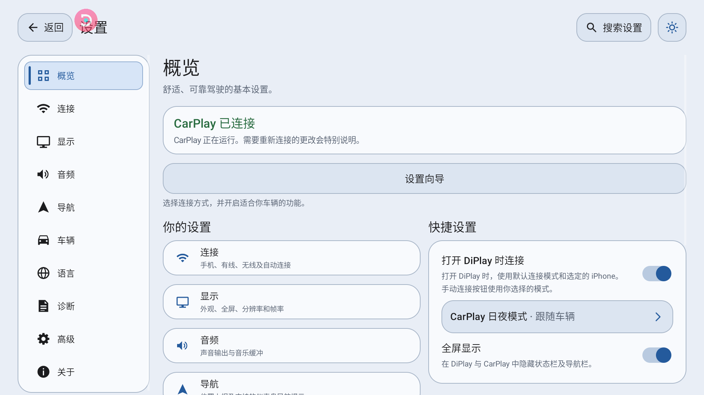
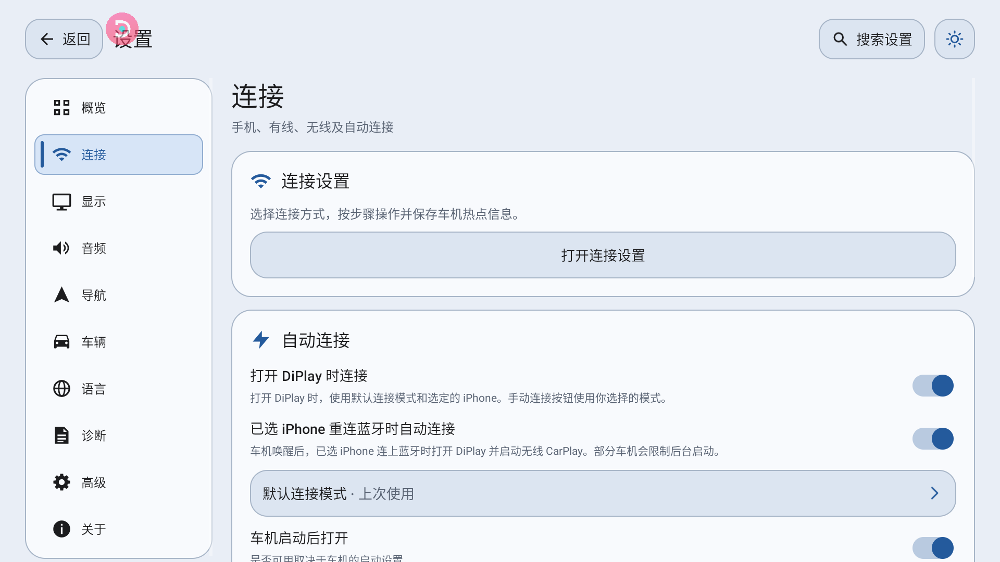
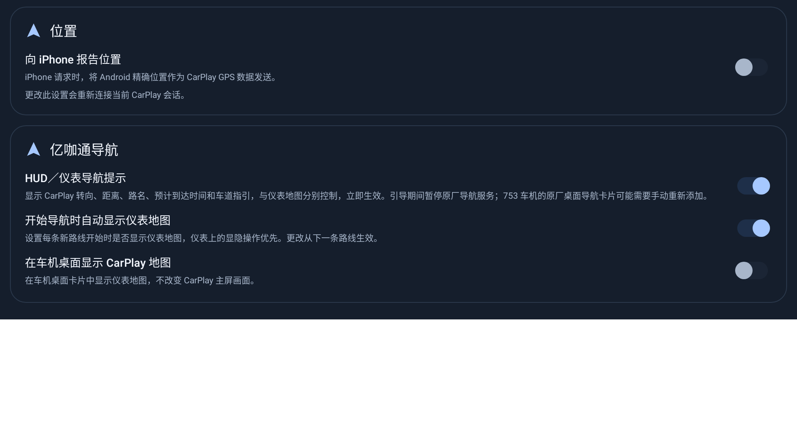
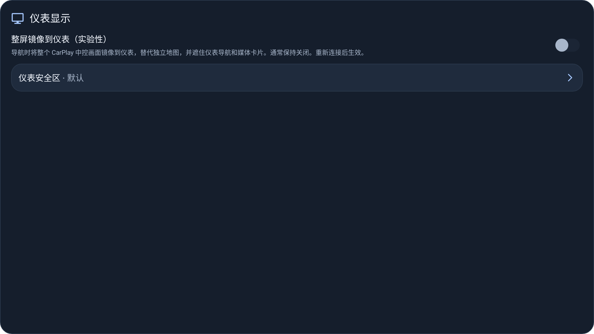
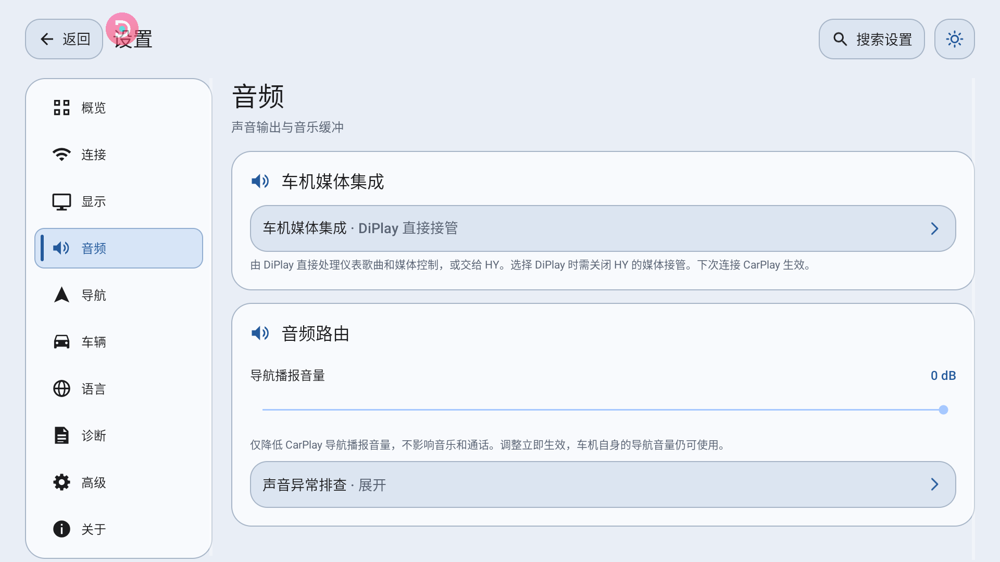
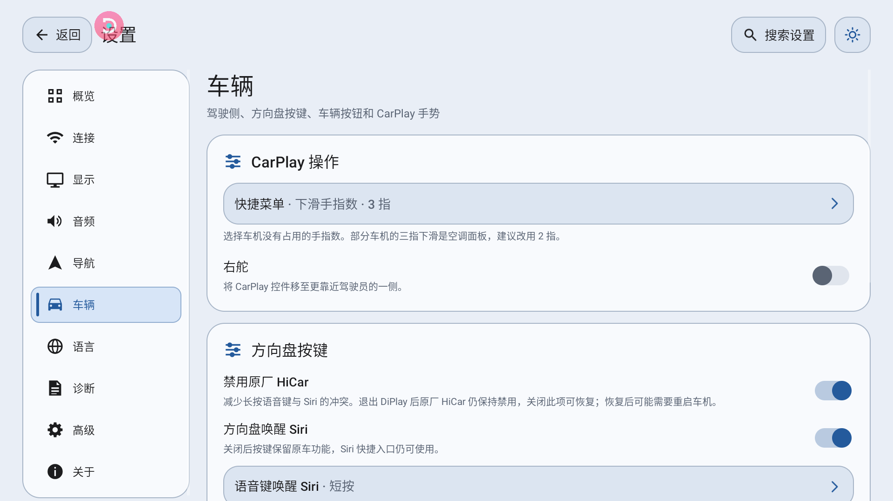
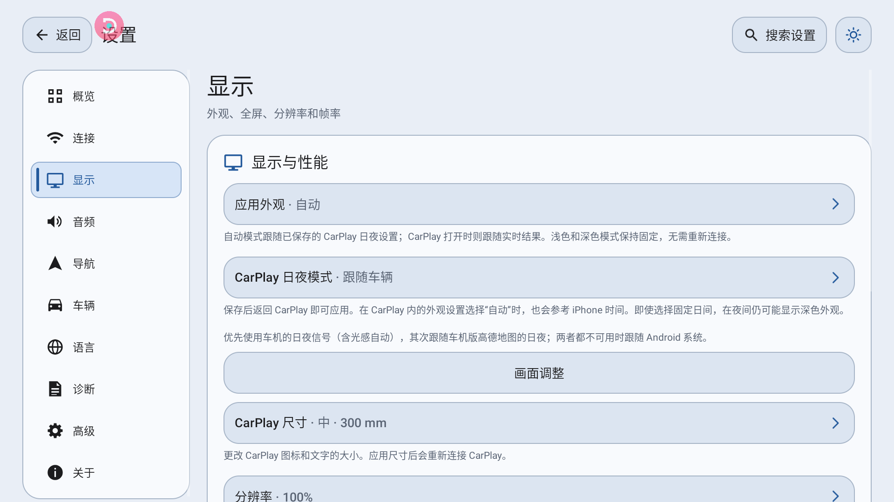
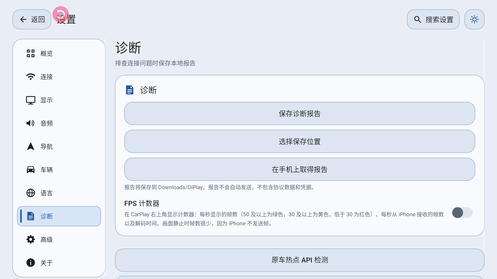

# DiPlay ECARX 功能与使用说明

- **适用版本**：`dev` 基线提交 `3af68076`，`versionCode 106`（`versionName 0.2`）。另行标注的 v107/v108 实测结果及后续工作区改动仅供参考，不代表 v106 已包含这些功能。
- **适用车机**：亿咖通（ECARX）车机，**车机版本 753**（高通 820A 平台）；当前在 **2021 款领克 01** 上验证。理论上同为领克 820A 平台的 753 车机都可用，其他版本未逐型实测。
- **这份文档解决什么**：把每个 ECARX 适配功能讲清楚——**在哪开、要什么前提、怎么用、怎么确认生效、什么时候别开**。车主照着开开关，测试同学照着判定对错，用的是同一份。
- **文中说的「HY」是什么**：**HYWebview**（包名 `com.hyphp.hywebview`），车机上的第三方桌面/媒体代理应用；我们适配并验证的版本是 **3.6.1**（versionCode 28）。下文出现的「HY 代理」「HY 方向盘设置」「HY 媒体接管」都指这个应用，不是车机原厂功能。

> 只想马上把车配好 → 跳到[第 8 节「三种推荐配置」](#8-三种推荐配置)。

---

## 0. 快速索引

本页浅色截图来自 v106 实车，显示当时保存的设置值，不代表各功能均已验收。

| 我想…… | 看这一节 |
| --- | --- |
| 仪表上看到导航箭头和剩余距离 | [3.1 仪表导航](#31-仪表导航) |
| 仪表上看到车道指引 | [3.2 仪表车道指引](#32-仪表车道指引实验性) |
| 仪表上看到歌名和封面 | [3.3 仪表媒体卡片](#33-仪表媒体卡片) |
| 把中控画面整个投到仪表 | [3.4 整屏镜像到仪表](#34-整屏镜像到仪表默认关闭) |
| 让仪表内容避开时速、转速表 | [3.5 仪表安全区](#35-仪表安全区) |
| 音乐走 CarPlay，电话还走车机 | [4.2 蓝牙媒体让位](#42-蓝牙媒体让位默认开启) |
| 车机日夜跟着车走，不用手动切 | [6.1 CarPlay 日夜模式](#61-carplay-日夜模式) |
| 每次上车自动连上 | [2.2 自动连接](#22-自动连接) |
| 热点老是 2.4 GHz 卡 | [2.3 热点](#23-热点自动启动优先-5-ghz) |
| 先用 USB 连过，之后无线连不上 | [2.5 连接失败原因怎么看](#25-连接失败原因怎么看) |
| 方向盘语音键想直接叫 Siri | [5.1 Siri 语音键](#51-siri-语音键) |
| 想改语音键是短按还是长按唤醒 Siri | [5.2 方向盘按键与语音键](#52-方向盘按键与语音键)（按键学习本版不显示） |
| 在车机上接打电话 | [5.4 电话：接听、挂断与声音避让](#54-电话接听挂断与声音避让实车已验证)（实车已验证） |
| 连不上 / 仪表没反应 | [7.3 排错表](#73-排错表) |

---

## 1. 前提

### 1.1 车机

| 条件 | 说明 |
| --- | --- |
| 车机版本 | **753**（领克高通 820A 平台）。同为该平台 753 版本的理论上都可用；其他版本未逐型实测 |
| 系统镜像带 ECARX XUI AdaptAPI | 仪表、车道、媒体卡片全走这套接口。接口类在车机系统镜像里，**不在 APK 内**，所以每个功能都是运行时探测 |
| 已授予必要权限 | 位置（导航上报给 iPhone）、通知、后台运行不受限；音量键接管等功能需要无障碍服务；CarPlay 自身的配对与信任按提示完成。**语音键短按不需要任何授权** |
| 车机签名 | 涉及系统接口的功能（媒体卡片、部分仪表调用）需要平台签名或车机已授权的 DIM 权限，普通安装包会静默降级 |

### 1.2 手机

iPhone 与车机完成过一次配对；无线连接要求 iPhone 的 Wi-Fi 与蓝牙都打开。

### 1.3 能力检测：为什么有些开关我没看到

DiPlay 启动时探测两类信息，然后**决定显示哪些卡片**：

1. **是不是亿咖通车机**：系统里存在 `com.ecarx.xui.service`、`com.ecarx.eas.service`、`com.ecarx.assistant`、`com.ecarx.xiaoka`、`ecarx.naviservice` 中任意一个，或 `Build` 的厂商字段带 `ecarx`。
2. **具体接口在不在**：对每个 DIM/媒体接口做一次类探测，缺哪个就关掉对应功能。

因此：

- 车机没被识别成亿咖通 → **「亿咖通导航」整张卡片不出现**。
- 识别成功但缺 `IMediaInteraction` → 导航功能照常，**仪表上的歌曲卡片不会有内容**（媒体集成仍然可选，只是推不到仪表）。

这不是 bug，是防止在不支持的固件上调用不存在的接口。

---

## 2. 连接

### 2.1 无线 CarPlay

**怎么用**

1. 打开 **设置 → 连接 → 连接设置**。
2. 选一种通路：车机热点、Wi-Fi Direct、或已有 Wi-Fi。
3. 按屏幕提示完成配置并保存。
4. 回到主界面连接 iPhone。

**怎么确认生效**：出现 CarPlay 画面即成功。连接期间界面会依次显示热点准备、握手、等待首个画面。

**边界**

- 车道级功能要有导航在进行；纯投屏不受影响。
- 无线失败有两种明确原因，见 [2.5](#25-连接失败原因怎么看)。

### 2.2 自动连接

**在哪开**：**设置 → 连接 → 自动连接**

| 开关 | 作用 |
| --- | --- |
| 车机启动后打开 | 车机开机后自动启动 DiPlay |
| 打开 DiPlay 时连接 | 进入 DiPlay 就自动连上一次选中的 iPhone |
| 已选 iPhone 重连蓝牙时自动连接 | 车机唤醒后，选中的 iPhone 连上蓝牙时尝试打开 DiPlay 并启动无线 CarPlay；可能受车机后台启动限制 |

**边界**：自动连接的目标是**设置里选中的那台 iPhone**，不是"上次实际连上的那台"。

### 2.3 热点（自动启动优先 5 GHz）

**自动启动时**：如果热点当前是关闭的，DiPlay 会把保存的 `apBand` 改成 5 GHz、清掉旧的 2.4 GHz 信道，并回读校验；SSID、密码、加密方式都保持不变。

**不会动的情况**

- 热点已经在跑 → 不碰。
- 你在车机设置里显式选了 2.4 GHz → 尊重你的选择。
- 车机无线不是双频，或写入后回读校验不过 → 回落到车机原来的频段。

「自动开启热点」可配合「车辆启动后打开 DiPlay」使用，两项开关都不强制检查 ADB。2026-11-02 后续源码统一了手动与自动热点权限预检：本车已有 `TETHER_PRIVILEGED` 时直接尝试系统接口，否则可允许「修改系统设置」。Android 9 的热点配置读写也直接使用系统权限，不需要 ADB。“自动加入热点”实验修复及专用 ADB helper 已删除，统一使用系统热点接口、标准连接流程与车机设置。通用热点启动的 ADB 兼容兜底仍保留，系统调用和热点状态回读才是成功依据。上述后续调整尚未纳入 v113 产物，仍待关闭 ADB 后实车验收，见 [ADB 与平台权限清单](ADB_AND_PLATFORM_PERMISSIONS.zh-CN.md#9-2026-11-02-自启与热点调整)。

**手动热点控制**：进入 **设置 → 连接 → 连接设置**，在「无线连接」步骤里有手动开关与状态显示（含车机移动网络是否就绪），自动流程失败时用它接管。

**边界**：这部分只在 Android 9 车机上验证过；不同固件对 `apBand` 的写权限不一致。

### 2.4 USB 与无线连接

建议首次配对直接使用无线。若首次通过 USB 建立了本车的 CarPlay 记录，之后改用无线前，必须先在 iPhone 上移除本车记录，再重新配对并先走无线，见 [2.5](#25-连接失败原因怎么看)。车机 USB 通路仍有问题，不建议作为稳定连接方式；USB 与无线切换及车机 USB 问题暂不继续排查。

### 2.5 连接失败原因怎么看

无线握手失败时，界面不再无限等下去，而是给出**两种原因之一**：

| 界面提示 | 实际发生了什么 | 你能做什么 |
| --- | --- | --- |
| 「这台 iPhone 表示它现在不能使用无线 CarPlay」 | iPhone 明确回了 `WirelessCarPlayUpdate available=false`，之后不再发起 Wi-Fi 传输 | 在 iPhone 上确认 Wi-Fi 已开；删掉这台车机的旧 CarPlay 记录后重新配对，并**先走一次无线**（见下文） |
| 「这台 iPhone 没有开始建立无线 CarPlay」 | iPhone 收下了请求但一直不发起传输 | 同上；这种情况 DiPlay 不会自动重试 |
| 连接超时 | 一分钟内没有拿到可用的传输 | 点「重新连接」 |

**关键行为**：只对**能自动恢复**的原因重试；需要你在 iPhone 上处理的原因，直接停下来并显示手动重连按钮。离开连接页会取消本次尝试。

#### 典型场景：先用 USB 连过，之后改走就连不上

已确认的情况是首次用 USB 建立记录后无法使用无线连接，可能停在连接界面，取消、重选设备或重进连接页无法解决。

已确认：首次通过 USB 建立的本车 CarPlay 记录会导致手机拒绝后续无线连接，需要在手机上移除记录并重新无线配对。iPhone 回 `available=false` 时，也应检查 Wi-Fi 是否开启。

握手日志中，两台手机在蓝牙配对、MFi 认证和 Wi-Fi 配置下发后出现不同响应：

| 步骤 | 先无线建立（正常） | 先 USB 建立（失败） |
| --- | --- | --- |
| 蓝牙 RFCOMM 连接 | ✅ | ✅ |
| iAP2 identification | ✅ | ✅ |
| MFi 认证 | ✅ | ✅ |
| 请求 Wi-Fi 配置（0x5702 → 0x5703） | ✅ | ✅ |
| **iPhone 回 0x4E0D WirelessCarPlayUpdate** | **available=true** | **available=false** |
| iPhone 回 0x4E0E / 0x4300 并请求传输 | ✅ | ❌ 从未出现 |
| 建立 AirPlay 会话 | ✅ | ❌ 永远到不了 |

也就是说，iPhone 从头到尾没有加入车机热点，热点侧的客户端列表里也查不到它。

**怎么处理（按顺序）**

1. 在 iPhone 上确认 **Wi-Fi 已开启**。
2. iPhone → **设置 → 通用 → CarPlay 车载** → 删除这台车。
3. 重新配对，并且**第一次连接走无线**（不要插线）。
4. 无线连接成功后正常使用；USB 与无线之间的切换不作为稳定功能承诺。

**DiPlay 侧已经改了什么**（`dev` 提交 `7e9e21c1`）：收到 `available=false` 后不再干等，60 秒内给出上面第一条的具体文案；这类只能由车主在 iPhone 上解决的原因**不再自动重试**（以前每 30 秒重试一次，等于重复同一个拒绝）；离开连接页会真正取消底层尝试，不再出现"重连了其实还是同一个死会话"。

---

## 3. 仪表与导航

> **导航 → 亿咖通导航** 分别控制 HUD／仪表导航提示、开始导航时自动显示仪表地图和可选桌面地图。整屏镜像与安全区校准在 **高级 → 仪表显示**。亿咖通专属设置仅在识别到兼容车机时出现。

### 3.1 仪表导航

**是什么**：把 CarPlay 的转向箭头、剩余距离、路名、预计到达时间推到仪表盘（走车机 DIM 接口），不依赖中控镜像。

**怎么用**

打开「HUD／仪表导航提示」后开始 CarPlay 导航。开关默认开启并保留旧版保存的选择，更改立即生效。关闭只撤下提示，手机路线、地图显隐和输入缓存继续保留。

临时缺少转向详情或下个转向距离时，仅撤下失效转向，继续更新有效的目的地、剩余距离、ETA 和车道。ETA 以剩余秒数提交给车机；手机只提供剩余时间时，先固定到达时刻，保活不会使其不断后移。

**怎么确认生效**：仪表出现箭头与距离；导航结束时仪表卡片自动清空。

**边界**：箭头用整型 id 通道，调用成功不等于实际绘制；地图显隐后顶部提示和车道是否连续显示，仍以实车画面验收为准。

### 3.2 仪表车道指引（实验性）

**怎么用**：随已开启的「HUD／仪表导航提示」输出有效车道数据，无需单独开启车道开关。

**和 3.1 的关系**：与导航数据一起更新；隐藏地图画面不会停止有效导航或车道数据。

**边界**：可用性取决于手机地图是否提供车道数据以及车机固件是否支持显示，不同车型表现可能不同。没有有效车道数据时不绘制车道，避免显示过期内容。

导航提示与初始仪表地图分别控制；通常无需开启整屏镜像。

**地图测试状态（2026-11-01）**：高德做过一些测试，但尚缺实际行驶导航测试。苹果地图仅发现车道显示问题，未做深入测试：v106 会丢弃提前到达的车道数据；v107 首次测试中用户确认车道箭头正确，但也曾在手机尚未要求显示时提前显示。v108 已安装，样本只覆盖隐藏状态下不提交车道；需要显示时的恢复、多分支方向与高亮仍待验证。苹果地图同样缺实际行驶导航测试。

### 3.3 仪表媒体卡片

**怎么用**：在「设置 → 音频 → 车机媒体集成」选择 DiPlay 或 HY，歌曲信息随所选后端自动输出。没有独立的仪表媒体卡片开关。

**怎么确认生效**：播放音乐时仪表出现歌名、歌手与封面。

**边界**：需要兼容固件与权限（ECARX MediaCenter）；没有权限时开关可能不出现或卡片无内容。媒体数据的后端选择见 [4.1](#41-车机媒体集成)。

### 3.4 仪表地图与三指飞屏

「开始导航时自动显示仪表地图」设置每条新路线的初始地图显隐，默认开启，更改从下一条路线生效。实际投送仍需有效 CarPlay 会话、导航路线、Surface 及当前视频源首帧就绪，中控继续使用自己的主视频流。

仪表「始终显示／从不显示」优先于初始开关；「自动」沿用本条路线开始时的设置。导航期间跟随仪表显隐通知和三指飞屏，页面重建和打开设置不会重置当前选择。

HUD 提示开启时，隐藏地图后有效导航数据继续输出。收起地图、替换 Surface 或临时失去视频源只暂停地图投送重试，不发送导航应用关闭，也不补发数据来抵消关闭副作用。窗口仍按原有策略释放，再次飞屏等待新绑定首帧后恢复投送；手机路线结束或断连才清场、释放导航应用并恢复本端暂停的原厂服务。

**高级 → 仪表显示 → 整屏镜像到仪表（实验性）**：默认关闭，通常无需开启。导航期间以整个 CarPlay 中控画面替代独立地图，可能遮住原车导航和媒体卡片。重新连接后生效，不会立即断开当前会话。

仪表菜单与三指交替操作、隐藏后的中控布局、顶部提示和车道连续性，仍需原车验收。

### 3.5 仪表安全区

**怎么用**：在 **高级 → 仪表显示** 点 **「仪表安全区」** → 拖动四边，让地图内容避开时速/转速等读数 → 保存。

**生效时机**：保存并**重新连接**后生效；「重置」恢复默认区域。

### 3.6 导航接管（v109）

当前工作区采用临时停用原厂 `ecarx.naviservice` 的方案，导航结束后恢复包状态并启动原厂服务；停包或恢复失败会留下诊断，不回退到 MQTT 距离纠偏。需要车机授予组件管理权限。

**桌面卡片**：停包可能删除原厂首页导航卡片的绑定。恢复原厂包后，需在原厂桌面进入编辑模式，点击空位「+」重新添加导航卡片；重新启用服务不会自动恢复绑定。

**验证边界**：v109 已在 Android 9 模拟器验证应用停包、结束恢复及强停后再次打开恢复；物理仪表上的距离和车道仍待实车确认。具体取舍见 [导航接管决策](NAVIGATION_TAKEOVER_DECISION.zh-CN.md)。

v106 曾通过 MQTT 距离主题纠偏，一轮实车压力 Mock 仅确认当时的错误距离可被纠正；当前工作区已移除该实现，不能用旧守护日志判断新接管方案是否运行。

---

## 4. 音频与媒体

### 4.1 车机媒体集成

**在哪开**：**设置 → 音频 → 车机媒体集成**

点进去只有两个选项：

界面上只有两个选项，名字不是「ECARX / Android」：

| 选项 | 内部值 | 谁向亿咖通提供媒体源 | 适合什么时候 |
| --- | --- | --- | --- |
| **DiPlay 直接接管**（默认） | `ECARX` | DiPlay 的 MediaCenter 直接注册、发布、清理 | 车机被识别为亿咖通时的常态 |
| **HY 代理**（即通常说的「HY 兼容模式」） | `ANDROID` | HYWebview 读取标准会话后代为发布 | 车机没被识别、或 ECARX 直接通道异常 |

**两种模式相同的地方**：都发布标准 Android MediaSession，嘟嘟这类桌面照样能读歌名、歌手、专辑、时长、封面和播放状态，也能用标准播放/暂停/上下曲控制 iPhone；都是**下次连接 CarPlay 生效**。

**两种模式真正的差别**

| | DiPlay 直接接管 | HY 代理 |
| --- | --- | --- |
| 亿咖通媒体源 | DiPlay 自己注册与清理 | HY 代理，DiPlay 不注册、不申请播放归属 |
| HY dashboard 封面补发 | 不发送 | 当前歌曲封面就绪后定向补发 |
| 媒体音频焦点 | 不申请（保留原 ECARX / 渲染器行为） | 渲染器已管焦点则不重复申请；否则按原策略 |
| 方向盘媒体键 | DiPlay 转发 | DiPlay 不接管，留给车机 / HY |
| 启动前置条件 | 直接发布 | 先等旧 ECARX 注册释放确认，再发布 |

**选择时的配套动作**

- **不使用 HY**：在 DiPlay 选「直接接管」，方向盘语音键按需选择短按或长按，无需配置 HY。
- **使用 HY，但由 DiPlay 直接接管**：在 DiPlay 选「直接接管」，在 HY 关闭媒体接管和同一语音键的方控接管，避免冲突。
- **使用 HY 代理**：在 DiPlay 选「HY 代理」，由 HY 代理媒体；在 DiPlay 和 HY 的方向盘设置中选择同一组 Siri 模拟按键，也可继续使用原有 Siri 桥接入口。见 5.1。

**怎么确认走到了哪一个**

诊断报告里看 `androidActivation`：`ACTIVE` 表示标准会话已起来；`WAITING_ECARX_CLEANUP` 表示在等旧注册释放；出现 `BLOCKED_ECARX_RESTART_REQUIRED` 说明清理结果不确定，需要重启 DiPlay 进程再试。

**边界**：这一项影响仪表媒体卡片、系统媒体控件、方向盘媒体键和 Siri 按键的归属，切换后建议重启一次 CarPlay 会话再判断。

### 4.2 蓝牙媒体让位（默认开启）

**解决什么**：CarPlay 导航播报和音乐被车机蓝牙"抢走"，或者音乐从手机蓝牙出来而不是 CarPlay。

**在哪开**：**设置 → 音频 → 蓝牙音频 → 「CarPlay 期间停用蓝牙媒体（实验性）」**

**怎么用**

1. 保持「CarPlay 期间停用蓝牙媒体」**开启**。
2. 确认 **「通过车辆蓝牙播放 CarPlay 音频（实验性）」关闭**（前者开启时该项会被禁用）。
3. 重新连接一次。

**边界**

- 只停用**所选 iPhone 的蓝牙媒体**，保留电话；CarPlay 结束后自动恢复。
- 需要车机支持 A2DP Sink。
- **下次连接生效**，当前通话或当前会话不受影响。
- 更深原理与验证记录见 [docs/BLUETOOTH_MEDIA_YIELD.md](BLUETOOTH_MEDIA_YIELD.md)。

### 4.3 通过车辆蓝牙播放 CarPlay 音频（实验性）

**是什么**：把 CarPlay 音频改从车机蓝牙出，而不是 CarPlay 自己的音频通路。

**什么时候开**：车机音响只认蓝牙输入、其他通路无声时。

**注意**：与 [4.2](#42-蓝牙媒体让位默认开启) 互斥——打开它，媒体让位开关会被禁用。

### 4.4 导航播报与音量

iPhone 会在导航播报前发 `duckAudio`。应用没有按其中的音量值直接调整音乐，默认也不会为播报申请音频焦点。

- 可在 **设置 → 高级 → 视频与音频**开启「音频焦点」，再开启「导航播报申请音频焦点」，重连 CarPlay 后生效。播报期间应用会申请可让其他声音降低的临时音频焦点；实际效果由车机和其他音源决定，其他声音也可能暂停。
- **设置 → 音频 → 音频路由 → 导航播报音量**调整的是播报本身，仅降低 CarPlay 导航音量，不影响音乐和通话，立即生效。

---

## 5. 语音与按键

### 5.1 Siri 语音键

**在哪开**：设置 → 车辆 → 方向盘按键 → **方向盘唤醒 Siri**。默认开启，关闭后不再接管 Siri 按键，下级选项隐藏。CarPlay 未连接或通话中不接管。

两种媒体集成方式下，这一块长得不一样：

| DiPlay 直接接管 | HY 代理 |
| --- | --- |
|  |  |

| 直接接管：选短按还是长按 | HY 代理：选按键组 |
| --- | --- |
|  |  |

- **DiPlay 直接接管**：选择短按或长按，另一种按法留给原车助手。默认短按，修改立即生效。
- **HY 代理**。选择 **155/156** 或 **312/303**，并在 HY 方向盘设置中选择对应的“模拟按键切换”。同组两个键码都唤醒 Siri。
- **Android 9 后台监听**。连接 CarPlay 后，DiPlay 监听系统日志中匹配所选键组的注入事件，前台应用仍收到原按键。需要 `READ_LOGS` 权限，授权后须重新连接 CarPlay；v106 没有一键授权入口。后续工作区增加了通过本机 ADB 尝试授权的入口，但尚未实车验证。
- **实车边界**：本轮车机已回读 `READ_LOGS granted=true`，但尚未完成后台 Siri 唤醒和识别的受控验证；新的一键授权按钮也不在实测 v108 中。HY 保存 155 时曾观察到 155 和 303 同时由输入层发出，312/303 模式尚缺严格对照。
- **显式 Siri 入口**：原有桥接应用及 `${applicationId}.action.SIRI` 事件继续可用，不受方向盘总开关影响；仍要求 CarPlay 已连接且不在通话中，也不会拉起 DiPlay 界面。

媒体后端的切换下次连接生效；Siri 总开关、短长按及虚拟按键选择立即生效。

### 5.2 方向盘按键与语音键

不提供按键学习、媒体键绑定或双击参数。上一首、下一首、播放/暂停保持固定功能，由既有媒体后端处理；音量保留车机行为，导航音量键仍由独立设置控制。

直接接管时需关闭 HY 的媒体代理及同一语音键的方控接管。HY 模式由 HY 负责原车方控，DiPlay 只监听选定的 Siri 虚拟键。两组切换码不表示短按和长按；原车短长按通过 ECARX 广播动作类型识别。

### 5.3 音量键调导航播报音量

**在哪开**：**设置 → 高级 → 「CarPlay 导航播报期间，音量键调节…」**

**作用**：只在 CarPlay 导航播报期间，把音量键指向导航音频流；其他时候按车机原有方式处理。

**边界**：需要方向盘按键无障碍权限；通话、地图缩放、摇杆保持优先。详见 [docs/NAVIGATION_WHEEL_VOLUME.md](NAVIGATION_WHEEL_VOLUME.md)。

### 5.4 电话：接听、挂断与声音避让（实车已验证）

**是什么**：iPhone 来电/去电时，车机的电话界面能看到来电，可以接听，也可以挂断；通话期间 CarPlay 的音乐和导航播报会暂停，挂断后自动恢复。

**怎么用**

1. 保持 CarPlay 已连接（蓝牙电话路径不需要额外开关）。
2. 用 iPhone 拨号，或等来电。
3. 在**车机的电话界面**接听或挂断。

**怎么确认生效**（实车 2021 款领克 01 已验证的行为）

| 环节 | 预期表现 |
| --- | --- |
| 来电 / 去电 | 车机电话界面显示来电信息 |
| 接听 | 通话走车机麦克风与音响 |
| 通话中 | CarPlay 音乐停、导航播报停 |
| 挂断（车机侧或手机侧均可） | 音乐与导航播报自动恢复 |

**原理（为什么会自动停/恢复）**：通话期间 Android 的音频模式离开 `MODE_NORMAL`，DiPlay 判定为「通话中」——这同时是语音键不抢按键的同一个条件；音频焦点收到暂时性丢失（`AUDIOFOCUS_LOSS_TRANSIENT`），媒体侧记为被中断；通话结束焦点回归，被中断的音乐恢复播放。

**边界**

- 通话中按方向盘语音键不会唤起 Siri（见 5.1 的生效条件）。
- 回声消除、人声滤波、通话采样率等实验性开关（设置 → 高级）**与已验证的基础通话无关**，默认保持原样即可。
- 已验证的是电话接打与声音避让；实验性通话音质选项未做实车验收。

---

## 6. 显示

### 6.1 CarPlay 日夜模式

**在哪开**：**设置 → 显示 → 显示与性能 → 「CarPlay 日夜模式」**

| 选项 | 依据 | 什么时候用 |
| --- | --- | --- |
| 跟随 Android 系统 | 系统夜间状态 | **默认**，最稳 |
| 跟随环境光 | 车机光感 + 阈值/延迟 | 有光感、想按实际亮度切 |
| **跟随车辆** | 车机日夜信号 → 车机版高德广播 → 系统 | 想和车机自己的日夜同步 |
| 始终日间 / 始终夜间 | 固定 | 调试或特殊场景 |
| 定时 | 车机本地时间的起止 | 固定作息 |

**「跟随车辆」怎么工作**

1. 主：读车机 AdaptAPI 的 `IDayNightMode`（启动时读一次当前值，之后靠回调）。
2. 兜底 1：车机版高德的标准广播（`KEY_TYPE 10019`，`EXTRA_STATE 30=日 / 32=夜`）——没有当前状态查询，首次要等地图应用发。
3. 兜底 2：Android 系统夜间状态。

**生效时机**：选完保存，回到 CarPlay 后生效。

**边界**：两个后端都靠反射调用，任何一步失败都不抛异常，只会退回下一层——所以"选了跟随车辆但还是按系统切"通常意味着车机没有可用信号。

**注意**：CarPlay 自身设置里若选了"自动"，它还会参考 iPhone 时间；即使你选了"始终日间"，夜间也可能显示为深色。

### 6.2 App 外观

**在哪开**：**设置 → 显示 → 显示与性能 → 「App 外观」**（深色 / 浅色 / 自动）。只影响 DiPlay 自己的界面，不影响 CarPlay 画面，切换**不需要重连**。

### 6.3 前台视频布局

系统栏显示时视频画面保持完整几何，不因系统栏高度变化重建会话。无开关。

---

## 7. 诊断

### 7.1 保存诊断报告

**怎么用**：**设置 → 诊断 → 保存诊断报告**。报告包含连接、仪表、媒体、按键的关键判定行，可在没有 ADB 的车机上直接导出。

截图仅确认入口；本轮导出尝试尚未确认取得新报告或成功提示。

### 7.2 报告里值得先看的行

| 关键词 | 说明 |
| --- | --- |
| `Cluster panel:` / `DIM guidance started` | 仪表画面与 DIM 导航是否真的起来了 |
| `transport=wireless` / `transport=wired` | 当前实际走的通路 |
| `USB fallback pending` / `USB detached: wireless preference` | USB 拔出后的回落判定 |
| `iap2 rx=0x4e0d wireless-carplay-update available=false/true` | iPhone 是否同意无线 CarPlay（false = iPhone 侧拒绝） |
| `iap2 no wireless transport after 60000ms` / `wireless CarPlay never started` | 60 秒等待窗口到点，界面已给出明确失败原因 |

### 7.3 排错表

| 现象 | 最可能的原因 | 动作 |
| --- | --- | --- |
| 仪表没有箭头 | 「仪表导航」没开，或车机未识别为亿咖通 | 确认卡片存在 → 开启开关 → 重新开始一次导航 |
| 开了镜像后箭头/歌曲没了 | 整屏镜像盖住了仪表卡片 | 关闭「整屏镜像到仪表」 |
| 声道不对、音乐从手机出 | 蓝牙媒体让位与"通过车辆蓝牙播放"配置冲突 | 按 [4.2](#42-蓝牙媒体让位默认开启) 重设后重连 |
| 音乐不会为播报让路 | 默认不申请播报焦点，或车机/音源未响应 | 见 [4.4](#44-导航播报与音量)，尝试播报音频焦点并重连 |
| 日夜不跟车 | 车机没有日夜信号，退回了系统 | 换「跟随 Android 系统」，或等地图应用发过广播后再试 |
| 无线一直卡在连接 | iPhone 拒绝或未发起传输 | 看 [2.5](#25-连接失败原因怎么看) 的提示文案 |
| 先用 USB 连过，之后改走无线就一直卡 | iPhone 上这台车的记录是有线建立的，iOS 拒绝无线 | 删掉 iPhone 里的本车记录 → 重新配对 → **第一次走无线** |
| 拔了 USB 没回到无线 | 无线可能未开启；首次 USB 建立的本车记录也会阻止无线连接 | 确认无线已开启；如首次通过 USB 建立记录，按上一行移除并重配 |
| 挂断后音乐/导航声没恢复 | 通话状态没被清掉（音频模式仍非正常）或焦点未回归 | 重新连接一次 CarPlay；若复现，保存诊断报告并记录时间点 |

---

## 8. 三种推荐配置

### A. 只要导航提示（最省事）

- 导航 → 亿咖通导航：**HUD／仪表导航提示** 开
- 开始导航时自动显示仪表地图：**关**，需要完整地图时用仪表显隐操作展开
- 整屏镜像到仪表：**关**
- 音频 → 车机媒体集成：**DiPlay 直接接管**（默认）
- 日夜模式：跟随 Android 系统

### B. 导航 + 音乐完整

- 导航 → 亿咖通导航：**HUD／仪表导航提示** 开；手机提供的有效车道随提示输出
- 音频 → 车机媒体集成：**DiPlay 直接接管**；如果安装了 HYWebview，在 HY 关闭媒体接管和同一语音键的方控接管
- 音频 → 蓝牙音频：**CarPlay 期间停用蓝牙媒体** 开；**通过车辆蓝牙播放 CarPlay 音频** 关
- 连接 → 自动连接：按需要设置启动、打开时连接和已选 iPhone 蓝牙重连时自动连接；后两者的触发方式不同
- 车辆 → 方向盘按键：**方向盘唤醒 Siri** 开，按需要选短按或长按
- 日夜模式：跟随车辆（车机支持的话）

### C. 排错 / 车测

1. 诊断 → 保存诊断报告（先留一份基线）
2. 每次只改**一个**开关，改完重连一次
3. 记录：改前现象、改后现象、报告文件名、时间点
4. 涉及仪表的改动，同时记录仪表实际显示（截图或视频），因为 DIM 调用成功不等于画出来了

---

## 9. 已知边界与未验证项

| 项 | 现状 |
| --- | --- |
| 导航播报压低音乐 | 默认不压低；可选播报音频焦点能请求其他声音让位，效果依赖车机和音源。`duckAudio` 的音量值没有直接控制音乐的消费方 |
| USB 连接 | 车机 USB 通路仍有问题，不建议作为稳定通路；USB 与无线切换及车机 USB 问题暂不继续排查 |
| 先 USB 后无线 | 属 **iPhone 侧行为**：首次用有线建立的本车记录会让 iOS 拒绝无线。DiPlay 已做到 60 秒内明确提示 + 不重试 + 取消干净，但**无法自动绕过**，须在 iPhone 上删记录并先走一次无线 |
| 仪表箭头或距离异常 | 当前工作区改为停包接管，先核对停包是否成功及导航输入；仍需实际行驶验收，见 [导航接管决策](NAVIGATION_TAKEOVER_DECISION.zh-CN.md) |
| 车道指引 | v109 模拟器已验证苹果与百度的车道显示。高德采集没有车道帧，实际行驶效果待验证。 |
| 自定义方向盘按键 | **本版不提供学习**：通过总开关及当前模式的 Siri 选项设置，其余按键保持固定功能 |
| 热点 5 GHz | 只在 Android 9 车机验证；写 `apBand` 失败会静默回落 |
| 日夜「跟随车辆」 | 依赖车机 AdaptAPI 与高德广播，两者都没有时退回系统 |
| 实车验收 | 多数功能仍是模拟器与代码级证据；**已实车验证**：电话接打与声音避让（见 5.4）。待验证项见 [docs/LYNK_01_PENDING_VALIDATION.md](LYNK_01_PENDING_VALIDATION.md) |
| 多语言 | 仅英文 / 简体中文 / 繁体中文；其他语言界面回落英文 |

---

## 10. 这份文档还缺什么

1. **实车逐项验收结果**：3.1–3.5 目前只有模拟器证据，缺"车机型号 + 固件版本 + 通过/失败"的实测表。
2. **媒体卡片所需权限的准确清单**：现在只写"需要兼容固件与权限"，具体是哪几个 DIM 权限需要在车机上抓一次。
3. **`duckAudio` 音量落地的实现计划**：是否补充直接调整音乐的 sink 侧 ramp，需要定；现有可选音频焦点不保证所有车机或音源都响应。
4. **英文版**：当前只有中文；README 的 English 段需要同步一份精简版链接。
